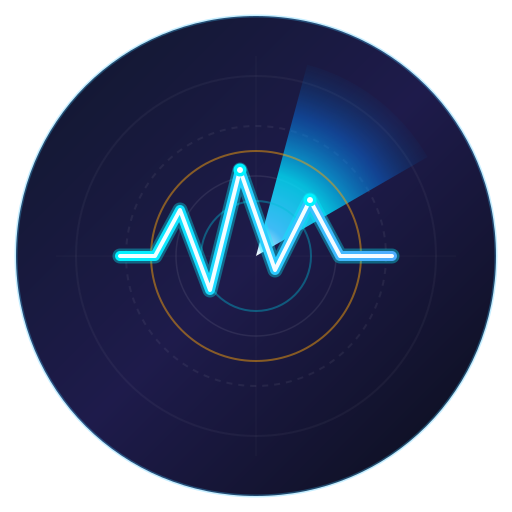

# StatusBarShow

An elegant Android system monitor powered by Jetpack Compose and Material 3, designed to keep real-time track of CPU, memory, and network speed right from your status bar notifications and on-screen floating windows.

---

## ✨ AI Improvements & Modernization

This version of **StatusBarShow** has been significantly enhanced and refactored with **AI assistance**:

- **Modern Architecture Refactoring**: Streamlined state management, lifecycle flows, and Kotlin coroutines (`SupervisorJob`, structured cancellation) replacing legacy multi-threading constructs.
- **Intelligent Resource Optimization**: Implemented smart screen-state awareness (`ACTION_SCREEN_OFF` / `ACTION_SCREEN_ON`) to automatically pause resource-intensive sampling when the screen is locked, reducing background battery drain to near-zero.
- **Dynamic Adaptive App Icon & Monochrome Theming**: AI-designed high-tech radar waveform vector icon with radial sweep gradients, precision border alignment, and full Material You monochrome adaptive icon integration.
- **Edge-to-Edge & Compose Polish**: Upgraded UI using Jetpack Compose with Material 3 components, comprehensive color palettes, dynamic curves, and responsive touch gestures.

---

## 🚀 Key Features

- **Real-Time CPU Monitoring**
  - Instantaneous overall CPU load and individual core workload curves.
  - Core frequency detection and CPU architecture introspection.
  - Interactive usage charts with a long-press memory feature (recording up to 20 historical datasets).
  - Configurable notification display modes: Normalized Usage (`Norm-Usage`) and Physical Usage (`Usage`).

- **Memory Usage Tracking**
  - Dynamic RAM consumption curve with available and total capacity readings.
  - Selectable notification metric units: Gigabytes Used (`Used-G`) or Usage Percentage (`Usage-%`).

- **Network Speed Meter**
  - Real-time download and upload rate measurement with automatic unit switching (KB/s, MB/s).
  - Dynamic on-the-fly status bar icon generation displaying live numbers.

- **Dual Display Modes**
  - **Status Bar Notification**: Non-intrusive foreground notification with `IMPORTANCE_LOW` (silent, zero vibration, no heads-up interruption) providing continuous, low-latency status bar metrics.
  - **Floating Window Overlay**: Resizable (5% to 15% of screen width), draggable overlay window that persists over other applications with position memory.

- **Theme & Personalization**
  - Dark Mode and Light Mode support with Material 3 styling.
  - Custom palette options for primary and secondary indicator curves.
  - Independent sampling intervals for network and CPU/memory (adjustable between 500ms and 3000ms).

---

## 🛠 Tech Stack

- **UI Framework**: Android Jetpack Compose & Material 3
- **Language & Runtime**: Kotlin (Coroutines, StateFlow / Compose State), JDK 21
- **Target OS**: Android 11.0 (API level 30) through Android 15 / 16 (API level 37)
- **Background Architecture**: Android Foreground Services with dynamic icon rendering and system intent receivers

---

## 🔒 Permissions

- `POST_NOTIFICATIONS`: Required on Android 13+ to display status bar indicator notifications.
- `SYSTEM_ALERT_WINDOW`: Required only if enabling the on-screen floating window overlay.

---

## 📄 License

This project is open-source and available under the [Apache-2.0 License](LICENSE).
